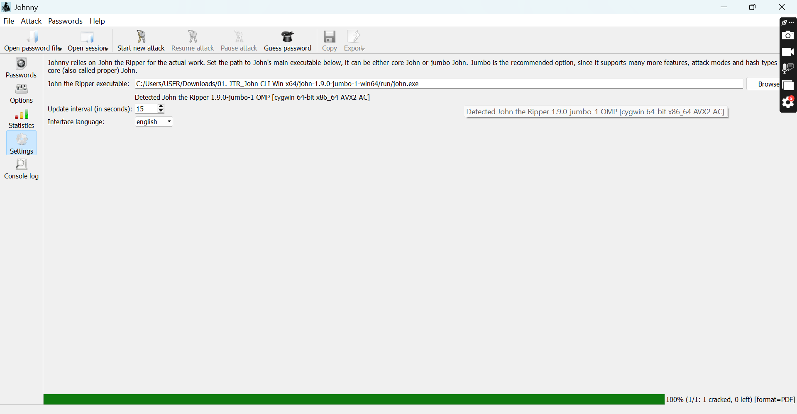
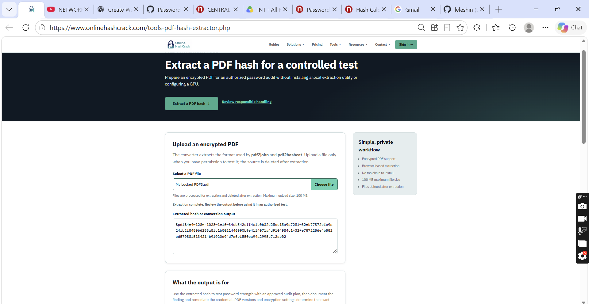
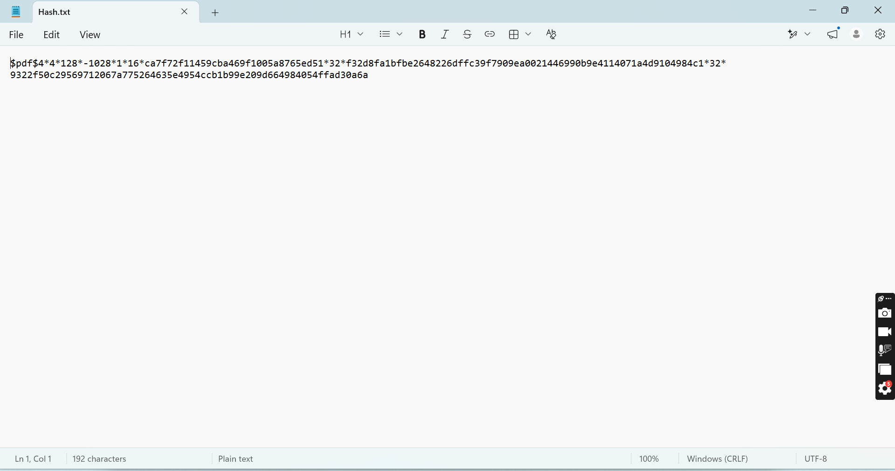
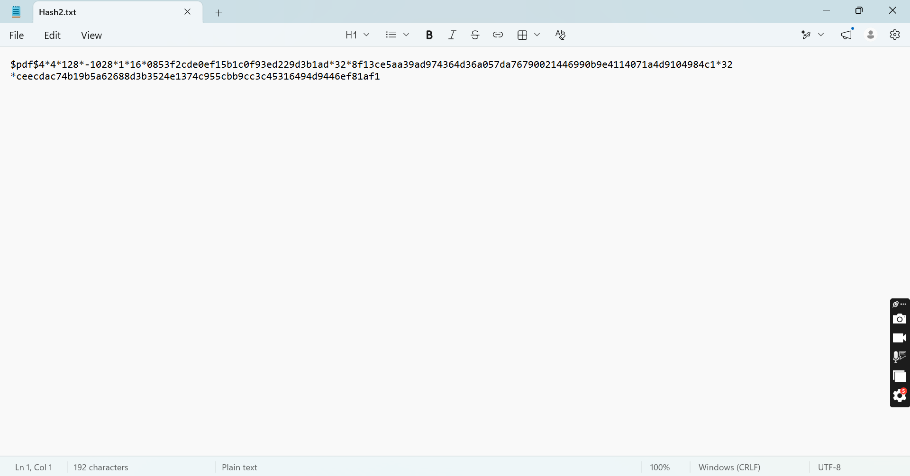

# 🔐 Cybersecurity Internship – B084
## Week 3: PDF Password Auditing, Recovery & Capture-the-Flag

**Hands-On PDF Password Security Assessment, Hash Auditing & Flag Validation**

**NETWORKWALKS | CYBERSECURITY & PENETRATION TESTING INTERNSHIP**

---

## 📌 Project Overview

This repository documents my hands-on experience with **PDF password auditing, password recovery and capture-the-flag (CTF) validation** during Week 3 of the NetworkWalks Cybersecurity and Penetration Testing Internship, Batch B084.

I used **Johnny**, a graphical interface for **John the Ripper**, to review a PDF password hash and the resulting password recovery. I also examined three password-protected training PDFs and recorded the congratulatory pages and challenge flags that opened afterward.

The screenshots confirm **one recovered password and show all three PDFs in both locked and opened states. They do **not** independently show a separate recovered password for each PDF or the precise attack mode and wordlist used.

**Module focus:** PDF password security assessment and recovery using Johnny / John the Ripper.

**Evidence dates:** 19 and 21 November 2026, as shown on the Windows taskbar in the screenshots.

The practical learning activities include:

- Reviewing the configuration of Johnny and its John the Ripper engine.
- Identifying the PDF hash format displayed in Johnny.
- Examining the completed password recovery status.
- Reviewing password prompts for three training PDFs.
- Confirming opened PDF documents and their challenge messages.
- Recording CTF evidence and evaluating password security lessons.

---

## 🎯 Project Objectives

1. Understand the purpose of password-protected PDF documents.
2. Identify Johnny and John the Ripper as password auditing tools.
3. Verify the John the Ripper executable path in Johnny.
4. Review the PDF hash loaded into the graphical interface.
5. Interpret the completed password-recovery status.
6. Record the recovered password shown by the tool.
7. Compare the locked and opened states of three training PDFs.
8. Document captured flags and screenshot evidence.
9. Explain the security risks of weak and predictable passwords.
10. Maintain ethical boundaries and accurate reporting.

---

## 🛠️ Tools and Supporting Environment

| Tool or environment | Purpose in my practical |
|---|---|
| Windows desktop | Run Johnny and the PDF viewer |
| Johnny | Graphical interface to manage and inspect password auditing |
| OnlineHashCrack PDF Hash Extractor | Browser-based extraction of a PDF hash for an authorized audit |
| John the Ripper 1.9.0-jumbo-1 OMP | Password auditing engine detected by Johnny |
| PDF format | Password hash format shown in Johnny |
| PDF viewer | Inspect password prompts and opened training files |
| My Locked PDF1.pdf | First training PDF challenge |
| My Locked PDF2.pdf | Second training PDF challenge |
| My Locked PDF3.pdf | Third training PDF challenge |

The screenshots show a Windows-based training exercise. This report is limited to the **authorized NetworkWalks training files** and does not document testing unrelated documents or systems.

---

## ⚙️ Step 1: Verify Johnny and John the Ripper Configuration

I reviewed the Johnny **Settings** page, where the John the Ripper executable path was populated and the application detected the installed engine.

### Screenshot 1: Johnny Configuration

*Figure 1: Johnny Settings showing the configured John the Ripper executable and detected engine.*

### Observations

| Field | Result shown in my screenshot |
|---|---|
| Engine | John the Ripper 1.9.0-jumbo-1 OMP |
| Platform | Cygwin 64-bit x86_64 AVX2 AC |
| Executable | `C:/Users/USER/Downloads/01. JTR_John CLI Win x64/john-1.9.0-jumbo-1-win64/run/john.exe` |
| Update interval | 15 seconds |
| Interface language | English |

I learned that Johnny depends on a working John the Ripper executable to perform the underlying password auditing work.

---

## 🧾 Step 2: Extract a PDF Hash for the Authorized Test

I used the **OnlineHashCrack PDF Hash Extractor** web page to prepare an encrypted training PDF for password auditing. The screenshot shows **My Locked PDF3.pdf** selected and the site reporting that extraction was complete. The output field contains a PDF hash representation beginning with `$pdf$`, suitable for use with compatible password-auditing tools.

### Screenshot 10: PDF Hash Extraction

*Figure 10: Browser-based PDF hash extraction for My Locked PDF3.pdf, with the extracted PDF hash visible in the output area.*

### Observations

| Field | Result shown in my screenshot |
|---|---|
| Website | OnlineHashCrack PDF Hash Extractor |
| File selected | My Locked PDF3.pdf |
| Processing status | Extraction complete |
| Output | PDF hash string beginning with `$pdf$` |
| Stated maximum upload size | 100 MB |
| Stated data handling | Site says files are deleted after extraction; this was not independently verified |

The screenshot confirms **hash extraction**, not password recovery by the website. It also does not establish that this exact extracted hash was the one used in the Johnny recovery result. The full hash is intentionally not transcribed into this public report.

### Security Consideration

Uploading encrypted documents to third-party websites may expose sensitive material. For confidential files, I would use an approved local extraction method instead, following the organization's data-handling policy. In this exercise, I documented only the authorized training-file workflow.

---

## 🧬 Step 3: Document the Extracted PDF Hash Strings

After extracting the PDF password-audit data, I saved the resulting **John-compatible PDF hash representations** in three text files. The screenshots below document the strings for the three training PDFs. These are **PDF encryption/hash records, not plaintext passwords**. Their `$pdf$` prefix and fields describe parameters and data used by a compatible offline password-auditing tool.

### Screenshot 11: Hash.txt — PDF1 Hash Record

*Figure 11: The PDF1 hash representation recorded in Hash.txt, with the complete 192-character record visible in the screenshot.*

### Screenshot 12: Hash2.txt — PDF2 Hash Record

*Figure 12: The PDF2 hash representation recorded in Hash2.txt.*

### Screenshot 13: Hash3.txt — PDF3 Hash Record

*Figure 13: The PDF3 hash representation recorded in Hash3.txt.*

### Hash Record Summary

| Training file | Saved hash text file | Observed format | Evidence |
|---|---|---|---|
| My Locked PDF1.pdf | `Hash.txt` | `$pdf$` record, 192 characters | Figure 11 |
| My Locked PDF2.pdf | `Hash2.txt` | `$pdf$` record, 192 characters | Figure 12 |
| My Locked PDF3.pdf | `Hash3.txt` | `$pdf$` record, 192 characters | Figure 13 |

**Important distinction:** The screenshots show the hash representations stored as text; they do not prove that every record was successfully cracked. The Johnny screenshot independently confirms one recovered password (`good-luck`) for one PDF hash. I preserved the full records in the screenshots rather than risk introducing transcription errors into the report. Hash records from real confidential documents should not be uploaded to public repositories.

---

## 🔑 Step 4: Review the Recovered PDF Password

I examined the **Passwords** page, which displayed a recovered password for one PDF hash. The bottom status bar reported that the job was complete.

### Screenshot 2: Password Recovery Result

*Figure 2: Johnny listing the recovered password and reporting one cracked hash with none remaining.*

### Observations

| Field | Observed result |
|---|---|
| Password | `good-luck` |
| Format | PDF |
| Hash prefix | `$pdf$4*4*128*…` (truncated on screen) |
| Status | `100% (1/1: 1 cracked, 0 left)` |
| User field | `?` |

This result demonstrates that the tested password could be recovered in the exercise. The screenshot does not show the attack mode, elapsed cracking time or candidate wordlist; I have not assumed those details.

---

## 📂 Step 5: Review Johnny's Password File Import Options

I examined the **Open password file** menu, which offers a password file in PASSWD format or another file format supported by John (`*2john`).

### Screenshot 3: Johnny Import Menu

*Figure 3: Johnny's menu for opening a password file or another John-compatible format.*

The screenshot records the available import options. It does **not** show which menu item was used to create the previously loaded hash, so I cannot verify the exact extraction steps from this evidence alone.

---

## 🔒 Step 6: Inspect the Locked Training PDFs

I opened each of the three training PDFs in the PDF viewer. Each document initially displayed a password-entry prompt.

### Screenshot 4: Locked PDF1

*Figure 4: My Locked PDF1.pdf requesting a password before opening.*

### Screenshot 5: Locked PDF2

*Figure 5: My Locked PDF2.pdf requesting a password before opening.*

### Screenshot 6: Locked PDF3

*Figure 6: My Locked PDF3.pdf requesting a password before opening.*

### Observations

- All three documents showed a password dialog in the PDF viewer.
- Their content was not displayed in the locked-state screenshots.
- Password protection is an access control, but its effectiveness depends on password strength and encryption configuration.
- These screenshots do not establish that all three documents shared the same password.

---

## 🏁 Step 7: Review the Opened PDFs and Captured Flags

Later screenshots show all three training PDFs opened successfully. The pages contain NetworkWalks congratulatory messages and highlighted flags.

### Screenshot 7: PDF3 Challenge Result

*Figure 7: Opened PDF3 displaying a NetworkWalks congratulatory page and highlighted flag.*

### Screenshot 8: PDF1 Challenge Result

*Figure 8: Opened PDF1 showing the first highlighted challenge flag.*

**Flag visible in PDF1:** `nw{cybersecurity_flag_captured_2608}`

### Screenshot 9: PDF2 Challenge Result

*Figure 9: Opened PDF2 showing the second highlighted challenge flag.*

**Flag visible in PDF2:** `nw{networkwalks_persistence_jtr_270521}`

The PDF3 screenshot also contains a highlighted flag. Its small text should be copied directly from the original PDF to avoid introducing a transcription error.

The opened-state screenshots confirm that the challenge pages were accessible at the time of capture; they do not independently establish the password used for each file.

---

## 📊 Findings and Interpretation

| Observation | What I learned | Suggested follow-up |
|---|---|---|
| Johnny detected John the Ripper | The GUI was connected to its password auditing engine | Preserve tool version and configuration evidence |
| One PDF hash was cracked | At least one tested password was recoverable | Evaluate password strength in the approved lab |
| Recovered password was `good-luck` | Human-readable passwords may be susceptible to guessing | Prefer long, unique, randomly generated passwords |
| Three PDFs requested passwords | PDF files can enforce password-based opening restrictions | Review PDF encryption and password policies |
| Three PDFs were later opened | Challenge completion can be documented with before/after evidence | Record which password opened each PDF if available |
| Challenge flags appeared | CTF flags demonstrate access to intended challenge content | Retain exact flags and original evidence securely |

**Scope limitation:** This exercise is a controlled training demonstration, not a confirmed vulnerability assessment of a production environment.

---

## 💡 Recommendations

1. Use long, unique passwords or passphrases for sensitive documents.
2. Avoid predictable words and common password patterns.
3. Use a password manager to generate and store strong passwords.
4. Apply modern PDF encryption where supported by the document workflow.
5. Share document passwords through a separate, approved communication channel.
6. Limit access to sensitive files and review who can retrieve them.
7. Store recovered credentials and hash files securely; do not publish real credentials.
8. Record the hash extraction method, attack configuration and duration during future exercises.
9. Preserve screenshots and results without overstating what the evidence proves.
10. Conduct password audits only on files you own or are explicitly authorized to test.

---

## 📚 Learning Outcomes

Through this practical project, I developed a better understanding of:

1. The purpose of password protection in PDF documents.
2. How Johnny interfaces with John the Ripper.
3. Recognizing a PDF hash in a password auditing interface.
4. Reading the completed password cracking status.
5. Interpreting a recovered password result.
6. Comparing locked and opened document states.
7. Understanding the role of CTF flags in training challenges.
8. Differentiating observed evidence from unverified assumptions.
9. Explaining the security importance of password strength.
10. Preparing clear technical documentation supported by screenshots.
11. Recording PDF hash representations in separate text files and distinguishing hashes from recovered passwords.

---

## 📎 Evidence and Report Files

| File | Description |
|---|---|
| [11-PDF1-Hash-Text.png](images/11-PDF1-Hash-Text.png) | Hash.txt screenshot showing PDF1 hash record |
| [12-PDF2-Hash-Text.png](images/12-PDF2-Hash-Text.png) | Hash2.txt screenshot showing PDF2 hash record |
| [13-PDF3-Hash-Text.png](images/13-PDF3-Hash-Text.png) | Hash3.txt screenshot showing PDF3 hash record |
| [10-PDF-Hash-Extractor.png](images/10-PDF-Hash-Extractor.png) | OnlineHashCrack extraction of a PDF hash from My Locked PDF3.pdf |
| [01-Johnny-Configuration.png](images/01-Johnny-Configuration.png) | Johnny configuration and detected John the Ripper executable |
| [02-Recovered-Password.png](images/02-Recovered-Password.png) | Recovered PDF password and completed status |
| [03-Open-Hash-Menu.png](images/03-Open-Hash-Menu.png) | Johnny import menu for password file or John format |
| [04-PDF1-Locked.png](images/04-PDF1-Locked.png) | Password prompt for My Locked PDF1.pdf |
| [05-PDF2-Locked.png](images/05-PDF2-Locked.png) | Password prompt for My Locked PDF2.pdf |
| [06-PDF3-Locked.png](images/06-PDF3-Locked.png) | Password prompt for My Locked PDF3.pdf |
| [07-PDF3-Flag.png](images/07-PDF3-Flag.png) | Unlocked PDF3 showing congratulatory flag |
| [08-PDF1-Flag.png](images/08-PDF1-Flag.png) | Unlocked PDF1 showing congratulatory flag |
| [09-PDF2-Flag.png](images/09-PDF2-Flag.png) | Unlocked PDF2 showing congratulatory flag |

**GitHub setup:** Extract this package, then upload `README.md` and the `images` folder together to your repository root. Keep filenames and folder structure unchanged so all screenshot links render correctly. The badges use externally hosted Shields.io images.

---

## 🛡️ Ethical Security Statement

I carried out this exercise as part of my educational cybersecurity training using designated NetworkWalks challenge documents. Password recovery and security testing must remain limited to documents and systems for which permission has been granted.

The recovered password shown here belongs to the training exercise. I would not publish real client credentials, private hashes or confidential document contents.

---

## 👨‍💻 About the Author

**Lamidi Olatunji Micheal Eleshin**

Cybersecurity & Penetration Testing Intern | Aspiring Cybersecurity Analyst | IT Auditor | IT Support Engineer | GRC & Risk Management

**Specialization Areas:**

Cybersecurity | Network Security | IT Auditing | Governance, Risk & Compliance | Penetration Testing | SOC Operations

**Internship:** NetworkWalks Cybersecurity & Penetration Testing

**Batch:** B084 | Week 3

**Project Focus:** PDF Password Auditing, Password Recovery, Johnny, John the Ripper & CTF Validation

**LinkedIn:** [Lamidi Olatunji Eleshin](https://www.linkedin.com/in/lamidi-olatunji-eleshin-4834252ab/)

---

**"Cybersecurity begins with vigilance. Failure to prevent a threat today may become tomorrow's data disaster."**

*— Lamidi Olatunji Micheal Eleshin*

